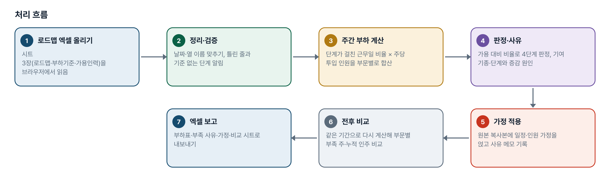
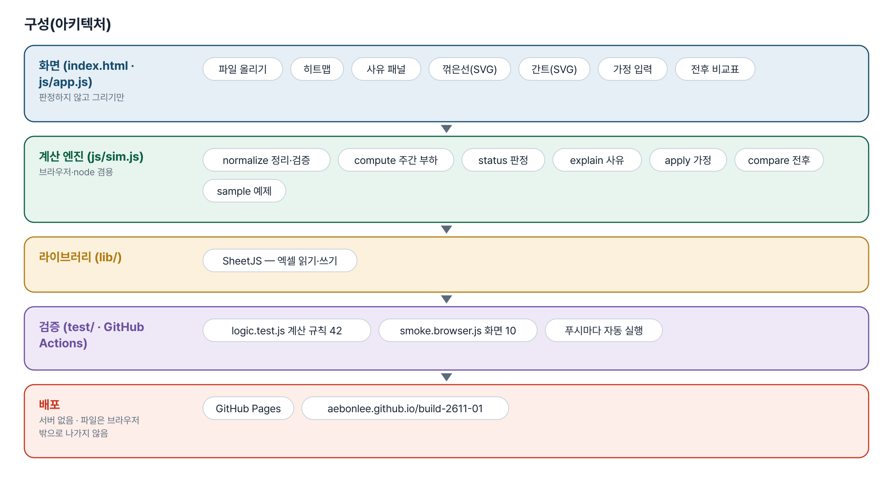
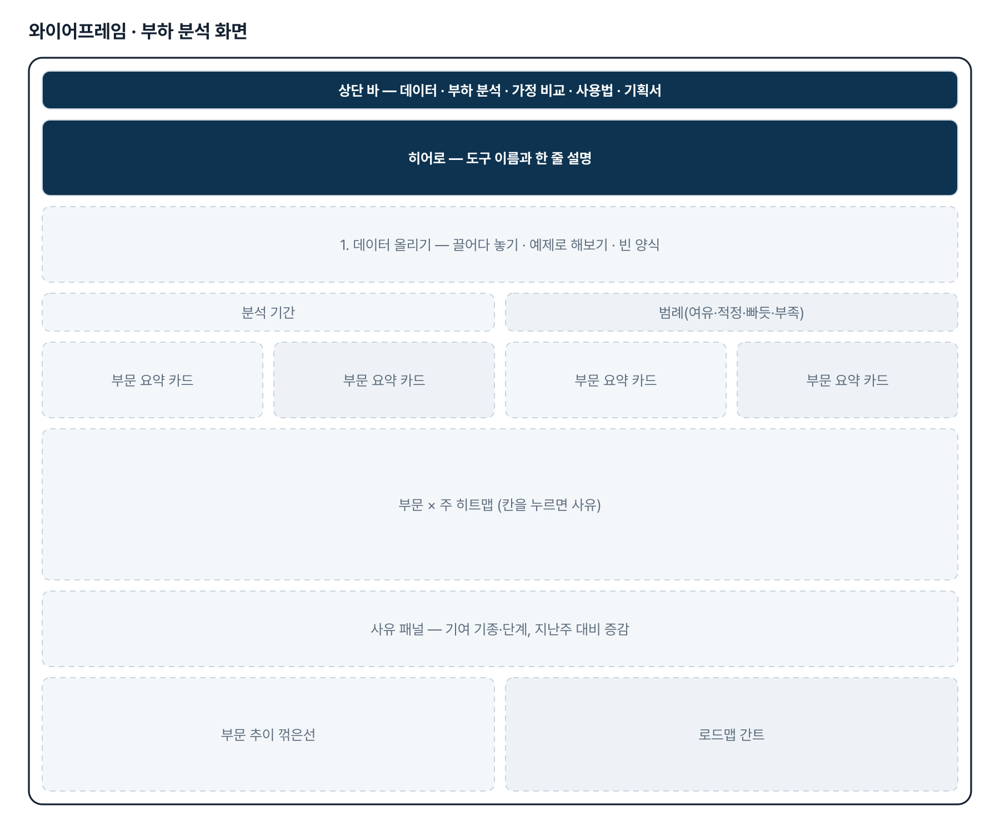
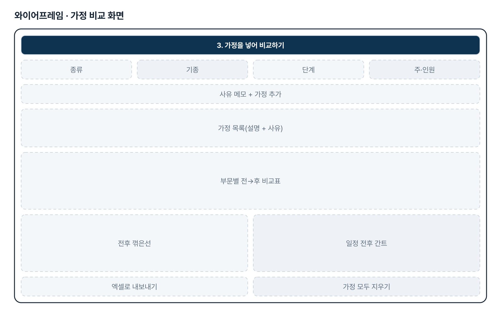
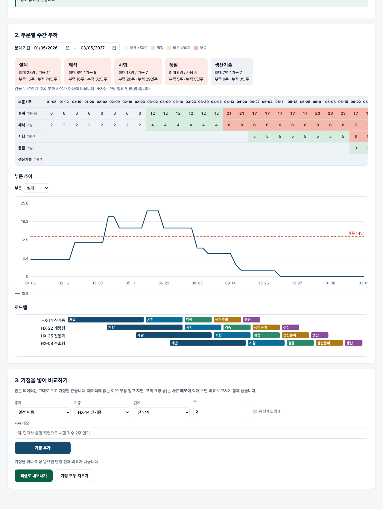

# 개발 계획 시뮬레이터 — 프로젝트 기획서 v1.0

- 기획: 정호영 · 작성일 2026-11-02 · 생성형 AI 업무자동화 전문가과정 · 2차수 프로젝트 01
- 바로 쓰기: https://build-2611-01.jobability.co.kr/
- 워드 판: `docs/기획서/build-2611-01_정호영_개발계획시뮬레이터_기획서_v1.0.docx`

## 개요

사내 로드맵 Raw Data(엑셀)를 올리면 개발부터 생산까지 부문별 주간 업무 부하를 계산하고, 부족 구간의 사유와 일정·인원 가정의 변경 전후 비교를 보여 주는 도구입니다.

### 배경 · 현재 업무
- 개발 절차는 기획-개발-시험-검증-생산준비-생산-출시로 진행되고 사내 로드맵으로 관리됩니다.
- 기종이 겹치는 시기에 어느 부문이 얼마나 부족한지를 미리 보기 어렵습니다.
- 일정이 바뀌면 부하를 다시 계산해야 하고, 데이터 밖의 사유(협력사 지연 등)로 바뀐 가정은 기록이 남지 않습니다.
- Claude·ChatGPT HTML 분석기로 초안을 만들었으나 분석 기준과 추가 입력값 기준이 정리되지 않았습니다.

### 목표
- 로드맵 파일을 그대로 올려 부문별 주간 부하를 즉시 계산합니다.
- 부족한 주마다 원인(기종·단계)과 지난주 대비 변화를 문장으로 설명합니다.
- 일정 이동·기간 변경·인원 변경 가정을 쌓아 변경 전후를 비교하고, 가정마다 사유를 남깁니다.
- 결과를 엑셀로 내보내 보고에 바로 씁니다.

## 요구사항과 구현

| 기획서 요구 | 구현 |
|---|---|
| 개발부터 생산까지 부문별 업무 부하 예상 | 로드맵 × 부하기준(단계·부문·주당투입) → 주별 부하표(히트맵) |
| 일정 변경 즉시 반영 | 분석 기간·가정을 바꾸면 곧바로 다시 계산 |
| Raw Data 그대로 분석 | 엑셀 시트 3장(로드맵·부하기준·가용인력), 열 이름 별칭 |
| 시각적·수치적 분석 | 히트맵 · 부문 추이 꺾은선 · 간트 · 부문 요약(최대·부족 주·누적 인주) |
| 증가/부족 사유 | 칸을 누르면 기여 기종·단계와 지난주 대비 시작·종료·증감 |
| 가정 상황 반영 · 전후 비교 | 일정 이동(뒤 단계 함께)·기간 증감·가용 변경·부하기준 변경, 부문별 전→후 표와 전후 꺾은선 |
| 데이터 밖의 사유로 바뀐 일정 표현 | 가정마다 사유 메모 — 비교 화면과 엑셀 「가정목록」에 함께 남음 |

## 주요 기능

- **데이터 올리기** — 엑셀 시트 3장을 읽고 날짜 형식(엑셀 일련번호·점·한글)을 맞춥니다. 틀린 줄은 버리지 않고 「확인할 것」으로 알립니다.
- **주간 부하 히트맵** — 부문 × 주 표에 필요 인원을 쓰고 여유·적정·빠듯·부족을 색과 숫자로 보여 줍니다.
- **사유 설명** — 칸을 누르면 그 주를 채운 기종·단계와 지난주보다 늘고 준 원인을 문장으로 설명합니다.
- **부문 추이 · 간트** — 선택한 부문의 주별 부하와 가용선을 꺾은선으로, 기종별 단계 일정을 간트로 그립니다.
- **가정 비교** — 가정 4종을 쌓고 사유 메모를 붙입니다. 부문별 전→후 표, 전후 꺾은선, 일정 전후 간트를 보여 줍니다.
- **엑셀 내보내기** — 주간부하 · 부족구간_사유 · 가정목록 · 전후비교 · 가정후_주간부하 시트를 만듭니다.

## 처리 흐름(파이프라인)

1. **로드맵 엑셀 올리기** — 시트 3장(로드맵·부하기준·가용인력)을 브라우저에서 읽음
2. **정리·검증** — 날짜·열 이름 맞추기, 틀린 줄과 기준 없는 단계 알림
3. **주간 부하 계산** — 단계가 걸친 근무일 비율 × 주당 투입 인원을 부문별로 합산
4. **판정·사유** — 가용 대비 비율로 4단계 판정, 기여 기종·단계와 증감 원인
5. **가정 적용** — 원본 복사본에 일정·인원 가정을 얹고 사유 메모 기록
6. **전후 비교** — 같은 기간으로 다시 계산해 부문별 부족 주·누적 인주 비교
7. **엑셀 보고** — 부하표·부족 사유·가정·비교 시트로 내보내기

## 구성(아키텍처)

- **화면 (index.html · js/app.js)** — 파일 올리기 · 히트맵 · 사유 패널 · 꺾은선(SVG) · 간트(SVG) · 가정 입력 · 전후 비교표
- **계산 엔진 (js/sim.js)** — normalize 정리·검증 · compute 주간 부하 · status 판정 · explain 사유 · apply 가정 · compare 전후 · sample 예제
- **라이브러리 (lib/)** — SheetJS — 엑셀 읽기·쓰기
- **검증 (test/ · GitHub Actions)** — logic.test.js 계산 규칙 42 · smoke.browser.js 화면 10 · 푸시마다 자동 실행
- **배포** — GitHub Pages · aebonlee.github.io/build-2611-01

## 화면 구성(와이어프레임)

## 규칙 · 판정 기준

- 주는 월요일 시작. 단계가 그 주 근무일(월~금)에 걸친 비율만큼 부하를 넣습니다(수요일에 끝나면 3/5).
- 기종 전용 부하기준이 있으면 그 기종·단계에는 일반 기준을 더하지 않습니다.
- 판정: 가용 대비 50% 미만 여유 · 90% 이상 빠듯 · 100% 초과 부족 · 가용 없음은 판정하지 않음.
- 가정은 원본을 복사해 적용합니다. 적용 대상이 없던 가정은 경고합니다.
- 부족 누적(인주) = 부족한 주마다 (필요 − 가용)의 합.

## 검증

- 계산 규칙 테스트 42개 · 화면 연기 테스트 10개 통과
- 처음엔 달력 날짜(/7)로 셌다가 「월~금을 채운 주 = 7명」 테스트가 실패해 근무일(/5)로 바꿨습니다. 되돌리면 같은 테스트가 다시 실패합니다.
- 화면 테스트: 예제 → 부족 칸 클릭 → 사유 → 가정 추가 → 전후 두 선.

## 이번 판에서 하지 않는 것

- 사내 로드맵 시스템 자동 연동은 하지 않습니다(내려받은 엑셀을 올림).
- 부하기준(단계·부문별 투입 인원)을 자동으로 정하지 않습니다 — 부서 협의로 표를 정합니다.
- 「매뉴얼 AI Chatbot」(기획1)은 보안 문서·이미지 인식이 핵심이라 이번 과정에서는 DAY4 RAG 실습 예제로 다룹니다.

## 다음 단계

- 과거 실적에서 부하기준을 역산하는 보조 화면
- 부문별 숙련도·외주 인원 구분
- 가정 묶음(시나리오 A/B/C) 저장과 세 개 이상 비교

## 버전 이력

- **v1.0** (2026-11-02) — 첫 판 — 주간 부하·사유·가정 전후 비교·엑셀 내보내기 / 기획서 워드 판·파이프라인·아키텍처·와이어프레임 추가
